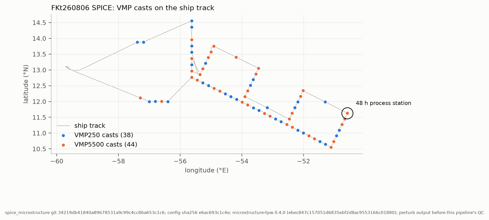
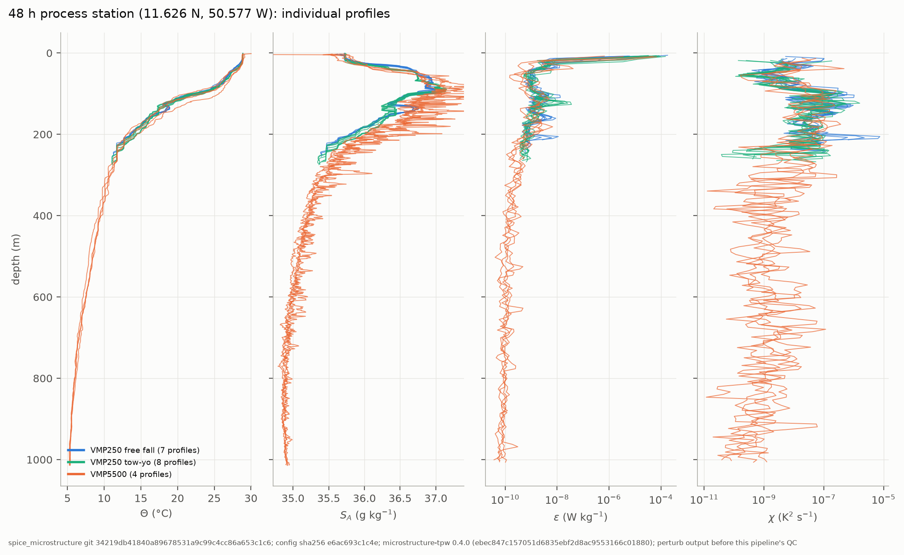
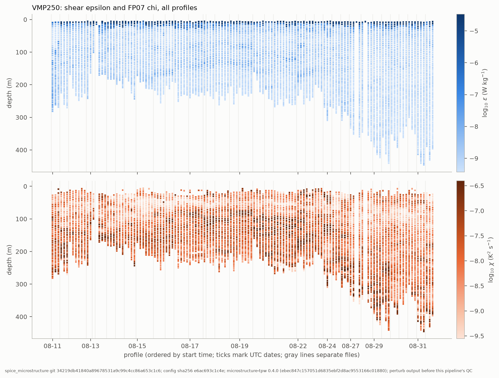
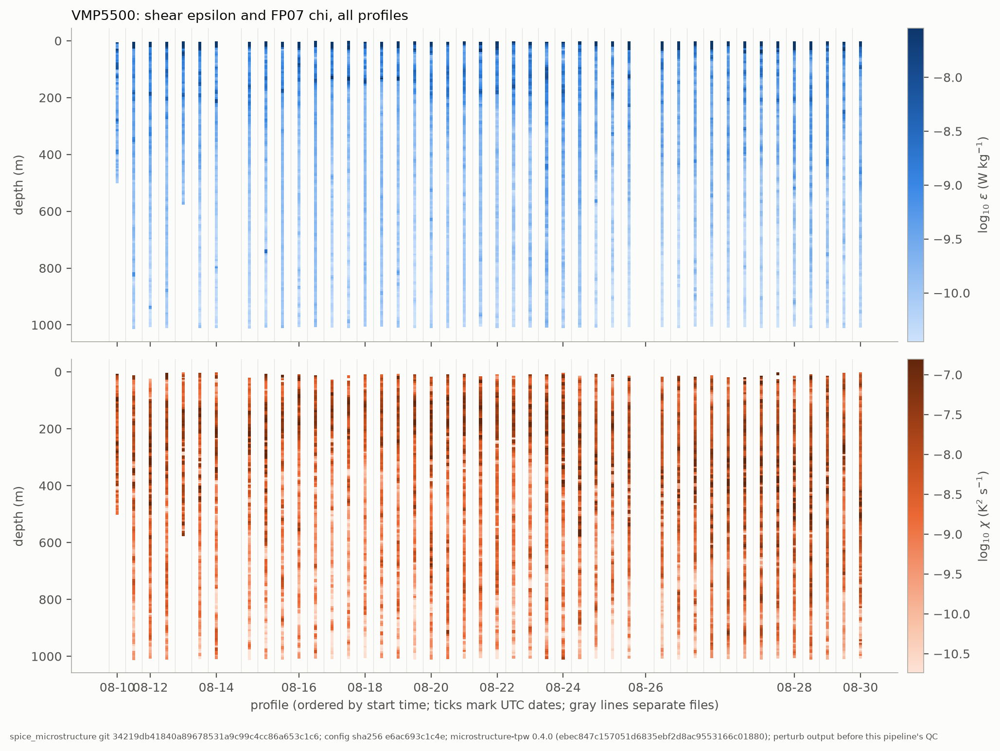
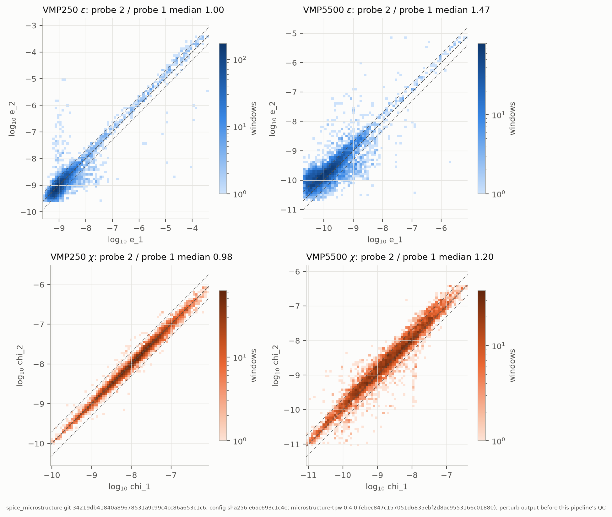

# Figures: run `baseline`

Provenance: spice_microstructure git 34219db41840a89678531a9c99c4cc86a653c1c6; config sha256 e6ac693c1c4e; microstructure-tpw 0.4.0 (ebec847c157051d6835ebf2d8ac9553166c01880).

All figures show perturb output before this pipeline's QC.

## cruise_map.png

Ship track (Sealog 5 min snapshots) with VMP250 and VMP5500 cast start positions; excluded casts omitted. Circle: 48 h process station.

## process_station_profiles.png

Process station profiles of conservative temperature, absolute salinity, shear epsilon (geometric mean of probes) and FP07 chi, by group: VMP250 free fall, VMP250 tow-yo (ship under way), VMP5500. 1 m bins; epsilon and chi are 16 s windows, so each profile has values every few metres.

## sections_vmp250.png

VMP250 epsilon (top) and chi (bottom) for every profile in time order, excluded casts omitted; each square is one 16 s window in its 1 m bin. Color limits are the 2nd to 98th percentiles.

## sections_vmp5500.png

VMP5500 epsilon (top) and chi (bottom) for every profile in time order, excluded casts omitted; each square is one 16 s window in its 1 m bin. Color limits are the 2nd to 98th percentiles.

## probe_agreement.png

Agreement between the two shear probes (top) and the two FP07 thermistors (bottom) per instrument, all windows. Dashed: 1:1; dotted: factor of 2. Excluded probes (e.g. VMP5500 sh1 on SPC_060-061) are not yet removed.
